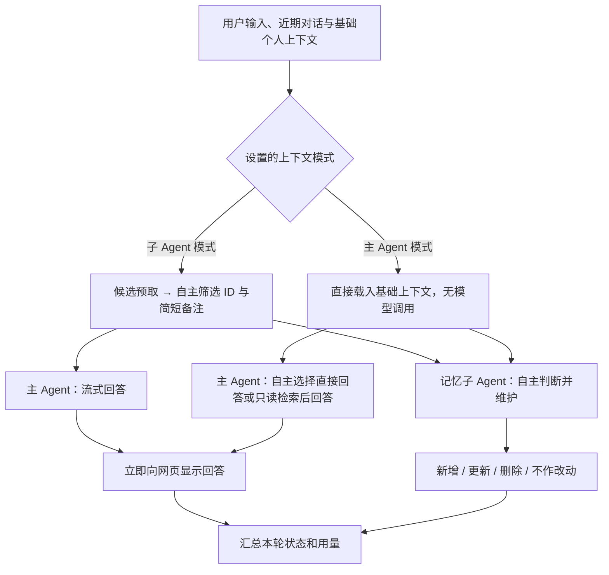

# 木记 Mori v2.8 — 候选预取与一次筛选 / 主 Agent 按需检索

本机网页个人 Agent，支持 DeepSeek / OpenAI GPT，以 **LangGraph 1.2.14** 编排。聊天和长期记忆保存在 SQLite，两个 Agent 使用同一 API 配置，但拥有独立的提示词、工具权限和调用历史。

## 一键启动

需要 Python 3.10+ 及支持 FTS5 的 SQLite（标准 Python 通常自带）。双击 `start.cmd`，首次启动会在项目中建立 `.venv` 并安装 LangGraph、NumPy 和 HTTPX，随后打开 http://127.0.0.1:8765。无需 npm、Docker 或独立数据库服务。

打开「连接设置」，选择 DeepSeek 或 OpenAI，填写 API Key 并保存或测试连接。Key 以明文保存在当前工作空间的 SQLite 数据库中，重启后自动读取，留空保存会保留现有 Key；勾选「清除该服务商已保存的 Key」会清除持久化记录中的 Key。更换 API 地址会清除旧 Key，也可同时填写适用于新地址的 Key。

也可将 `.env.example` 复制为 `.env` 后在本机编辑。匹配当前 API 地址的环境 Key 会在首次启动时导入数据库；此后数据库里的已保存或已清除状态优先，清除后不会因 `.env` 仍有值而重新出现。无需加密密码或额外依赖。网页只在本机开放，调用 DeepSeek / GPT API 仍会联网。

双击 `stop.cmd` 停止服务，数据保留。关闭网页不等于停止服务。

手动启动、测试与停止：

```powershell
python -m venv .venv
.\.venv\Scripts\python.exe -m pip install -r requirements.txt
.\.venv\Scripts\python.exe server.py --open
.\.venv\Scripts\python.exe -m unittest discover -s tests -v
.\.venv\Scripts\python.exe server.py --stop
```

端口冲突时，启动和停止命令都添加 `--port 8768`；8767 留给独立记忆测试空间。升级后应重新启动服务；已有会话、记忆、待办、非敏感设置兼容，不需删除数据库。

## 模型名称与详细设置

v2.7 的模型和 Embedding 请求共享本机 HTTP 连接池，按服务端允许复用连接；每个请求单独携带当前 Key，不在连接池默认头中保存 Key，不跟随重定向，不自动重试。OpenAI Responses 和 DeepSeek Chat Completions 默认使用 SSE 流式请求，兼容仍返回 JSON 的网关。子 Agent 的工具参数完整接收、校验后才执行，记忆维护继续与主 Agent 回答并行；主 Agent 接收交接后逐段显示回答。仅完整响应作为成功回答保存；流中断时保留已接收文字并标记“回答未完成”，后续对话不会将其作为有效回答上下文。

流程节点新增每次模型请求的连接建立、响应头、首输出、首输出后和总耗时，以及是否复用连接。响应头、首输出均从请求发起计时；首输出指可见文本或工具参数，不展示隐藏思考。等待包含服务端处理和网络延迟，首输出后包含后续生成、传输和本机处理，无法直接测量纯模型计算或排队时间。旧记录及整包 JSON 返回缺少分项时显示“—”，不会补成零。当前优化仍采用 HTTP，WebSocket 续接和候选预取留待独立比较。

页面右上角直接显示服务商与当前配置的模型名称，输入框上方显示思考强度、生成 Token 上限和联网状态。点击任一处或左下角「连接设置」修改；各服务商的模型参数分别保存，Agent 上下文与执行上限为全局设置，下一轮生效。

| 设置 | 含义与适用范围 |
| --- | --- |
| 思考强度 | DeepSeek 支持 auto / none / low / high / max；OpenAI 可选择 auto / none / minimal / low / medium / high / xhigh，具体模型须支持。auto 不发送该参数，none 请求关闭思考 |
| 生成 Token 上限 | 每次 API 请求的上限，覆盖思考和可见回答，不是精确思考链长度；应用允许 256–131,072，模型可能有更低限制 |
| 请求超时 | 每次请求 10–300 秒；默认 90 秒 |
| Temperature / Top-P | 留空表示不传参数。DeepSeek Temperature 仅关闭思考时可用，Top-P 仅思考模式可用，范围 0.95–1；OpenAI 是否支持取决于模型 |
| API 回答详略 | OpenAI 主 Agent 可设置 low / medium / high；默认不传。DeepSeek 可通过「回答风格」表达详略偏好 |
| 联网搜索 | OpenAI 主 Agent 的 Responses 内置 web_search，默认关闭；模型按需决定是否搜索，显示来源链接及工具动作。当前 DeepSeek 适配器未接入搜索，界面禁用该开关 |
| 上下文上限 | 近期消息数量和字符预算、默认基础记忆条数和 JSON 字符预算；这些是应用预算，不代表模型自身上下文窗口 |
| 上下文处理方式 | `specialist`：子 Agent 预取候选与筛选交接（默认）；`main`：主 Agent 自主选择直接回答或只读检索，无前置分类调用 |
| 候选预取与交接备注 | 子 Agent 模式默认先用本轮原文搜索最多 12 条候选，尽量一次筛选；不足时仍可补查。默认备注最多 240 字符（可调 64–1000），原始事实按 ID 传递 |
| 模型调用上限 | 召回、维护，以及主 Agent 按需检索模式各最多 1–12 次模型调用；每次最多 1–4 个工具请求。固定最多 8 项记忆改动、两个并行分支、单条消息最多 12,000 字符 |

原有设置升级后继续保持 DeepSeek 思考关闭、OpenAI 使用服务商默认、生成上限 4096、联网关闭。选择自定义模型或网关时，它可能不接受所选参数；「保存并测试连接」可检查配置是否兼容，连接测试自身不调用搜索。

回答下方及流程节点显示接口报告的实际思考 Token；未返回统计时显示「接口未提供」，不会把未知当作零。这里只展示用量，不展示内部思考文本。每轮保存非敏感参数快照，历史记录显示当时的参数。网页搜索只开放给主 Agent；语义检索另外调用 Embedding API。文件、系统命令和设备控制未接入。

## 每一轮如何运行



两种上下文模式均保留独立记忆子 Agent 的并行维护；没有固定关键词或语义分类器替模型决定是否检索或记忆：

1. **子 Agent 模式**：基础个人上下文始终载入。程序按本轮原文做候选检索，由模型决定相关性；候选足够时一次 `memory_context` 提交 ID 和短备注，避免重复抄写原始事实。无关候选不进入主 Agent；查不到、指代不清或需要更多信息时，子 Agent 仍可自主改写查询。
2. **主 Agent 模式**：基础上下文与路由资料直接传给主 Agent；同一次生成通过 `tool_choice=auto` 自主选择直接回答或调用只读 `memory_search` / `memory_list`。没有独立的判断请求、子 Agent 整理请求或摘要交接。主 Agent 不获得写入工具；检索后直接流式回答。达到调用上限时明确报错，不编造答案。
3. **并行工作**：LangGraph 在同一 super-step 启动 `answer` 和 `consolidate`。记忆子 Agent 每轮独立决定保存、修改、删除或不改动，主 Agent 是否检索不影响这项判断。主 Agent 的工具读取不会改写共享图状态，维护分支使用自己的上下文和查询历史。
4. **分别完成**：回答一完成就推送到页面。记忆子 Agent 尚未完成时，页面显示处理中；完成后显示改动或跳过结果及简短说明。任一模型分支失败不丢弃另一分支的结果。

子 Agent 模式需要先完成筛选交接；主 Agent 模式直接开始回答，不等待子 Agent 整理。需要额外记忆时，主 Agent 仍需经过工具调用、检索返回和后续模型生成，因此回忆题不保证比预取模式更快。工具调用轮中的临时文字会在检索时清除，只持久化最终回答。两种模式的**回答生成与记忆判断本身真正并行**。本轮结束仍等待两边收尾，期间不能发送下一轮或修改设置。

## 新对话默认带上个人信息与偏好

开启新对话时，首页的「新对话的基础上下文」可以展开查看准备载入的记忆。发送第一条消息时，即使只是问候，「关于我」「偏好习惯」及置顶条目也会按容量直接载入；子 Agent 模式随交接传给主 Agent，主 Agent 模式直接传入。不依赖模型主动查询，也不要求说“你记得我吗”。

- 每轮从当前记忆库重新读取；更新或删除会在下一轮预载时生效，不在会话中保存一份永久副本。历史消息仍可能包含旧事实，和之前一样需要单独管理。
- 这是读取默认上下文的策略；新增、更新、删除或不记忆的语义判断仍由子 Agent 自主完成。只读模式也能使用已保存偏好。
- 预载不创建记忆、不插入虚构聊天、不单独调用 API。点击新对话仅展示预览，发送消息才把上下文交给配置的模型。
- 已预载条目与子 Agent 查询结果按 ID 去重；额外上下文整理失败时仍保留已载入的基础资料，并显示失败状态。本轮明确表达优先于旧偏好。
- 默认预载最多 24 条、模型侧记忆列表 JSON 最多 12,000 字符，可在高级设置调整；按置顶优先、最近更新排序，保留完整条目。超出预算的条数会在首页和流程中显示，可由当前模式的检索 Agent 查询其余内容。
- 回答下方显示基础上下文条数，流程图的「接收消息」「整理上下文」节点可查看实际载入的内容。已有聊天和流程不会补写或重算。

## Agent 流程可视化

左侧打开「Agent 流程」，或在回答下方点击「查看流程」。也可以直接访问 http://127.0.0.1:8765/#flow。

- 图中显示接收消息、上下文交接、主 Agent 回答、并行记忆维护和汇总五个节点。状态和耗时来自后端实际执行事件，打开页面后也可重新获取正在运行的记录。
- 点击节点查看上下文摘要、记忆维护结果、简短说明、工具动作、模型调用次数和 Token 用量。
- 时间线可以点选、拖动或逐步回放。回放按事件还原当时状态，节点不会提前显示后续结果；「显示最新」返回该轮末次状态，「跟随最新」跟踪最近一轮。
- 下拉菜单显示最近 50 轮，也可以通过历史回答打开更早的记录。升级前的旧消息没有流程记录；空白视图仅展示结构。
- 流程记录保存在同一 SQLite 数据库，包含输入预览和上下文摘要，不包含 API Key、完整 API 请求或模型内部推理。导出包含记录，删除会话会同时删除该会话的流程记录。记录不会再次作为模型上下文输入。
- 服务意外停止后，未完成的节点标记为「已中断」，保留末次观测值，不虚构结束时间。

## 自主判断与代码校验的区别

是否有长期价值、是否为真实的用户信息、是否重复、是否发生变化、如何理解“不要记录”，都由记忆子 Agent 结合上下文判断。

已移除 v1 的 `记住/remember` 关键词门槛、敏感内容正则和 `content == evidence` 原文相等要求。子 Agent 可以提炼、概括内容，也可以决定不记录，即使输入包含“请记住”。提示词描述它的职责、用户意愿和事实依据，代码不替模型做内容判断。

代码仍验证结构和执行边界：

- 工具参数必须符合类型、字段与长度约束。
- 更新或删除必须引用已经读取过的真实记忆 ID（来自基础上下文或查询工具）。
- 提交时核对版本，防止覆盖后来发生的修改。
- 一组操作在同一个 SQLite 事务中执行，任一项出错会全部回滚。
- 每次最多 8 项改动，模型可根据工具错误纠正后重新提交。
- 「允许记忆子 Agent 自主维护」关闭时为**只读权限**。子 Agent 仍接收每轮输入、查询并交接上下文，但不能写入。这是用户权限开关，不是根据句子内容决定是否启动 Agent 的规则。

保存的依据由子 Agent生成，可概括说明，不代表经过独立事实核查。实际记忆质量取决于模型；可以在记忆页检查、编辑和删除。

## 角色与工具

| 角色 | 可用能力 |
| --- | --- |
| 主 Agent | 接收基础上下文与对话，流式回答；`main` 模式有只读 `memory_search` / `memory_list`，`specialist` 模式接收子 Agent 交接。可在 OpenAI 中启用内置联网搜索；没有写入权限 |
| 记忆子 Agent，交接阶段 | `memory_search`、`memory_list`、`memory_context` |
| 记忆子 Agent，维护阶段 | `memory_search`、`memory_list`、`memory_decide` |
| 网页操作 | 手动新增/编辑/置顶/删除记忆，添加/完成/删除待办，导出数据 |

`memory_decide` 提交 `create / update / delete` 操作列表；空列表意味着模型决定不作改动。页面显示最终结果与简短说明，不展示模型内部思考过程。

主 Agent 负责回答，写入判断始终由独立子 Agent 完成。待办在网页手动管理；普通解释和算术问题仍可询问模型。

## 长期记忆

基础个人上下文默认载入，其余内容由模型自主选择查询和交接。查询工具底层使用英文词项和中文单字/双字片段的 BM25 检索，也可分页浏览全部记忆。置顶既影响预载优先级，也影响浏览顺序。

v2.6 使用持久化 SQLite FTS5 / BM25 索引，中文仍使用单字、双字片段，英文使用词项。普通查询不读取整个记忆快照。数据库触发器记录新增、修改、删除，包括直接 SQL 修改且未改变时间戳的情况；下次查询只同步变动文档。重启可复用已有索引。FTS5 的 BM25 排序与旧 Python 版可能不同。

模型自主选择关键词、拆分或改写查询，每次搜索最多返回 12 条候选；分页浏览每次最多 20 条。候选需要模型筛选，中文单字重合会产生无关候选，同义表达缺少词项重合时可能漏召回。4 种分类是记忆用途，不是领域过滤器；目前没有固定的领域路由或语义分类器。

每阶段默认最多读入 24,000 字符的完整记忆列表 JSON，包含阶段预载和每次工具返回；主 Agent 原始记忆交接默认最多 16,000 字符。两项均可在连接设置的高级参数中调整。超过容量时省略整条记忆并报告省略数量，不切断事实。提示词、近期对话、摘要、工具定义和工具元数据另外占空间，字符预算不等于 Token 上限。工具只向模型发送精简字段，数据库完整版本留在后端供事务验证；维护阶段也不会再次全量注入所有已读条目。

这些是上下文容量限制，不判断是否值得保存。每条用户输入仍进入模型，新增、提炼、合并、更新、删除或不改动由记忆子 Agent 判断。流程详情现在显示真实查询词、分页偏移、返回条数、本地读取耗时及容量省略信息。

可在「连接设置 → 记忆召回」启用 Embedding API，默认模型 `text-embedding-3-small`、1536 维。可复用已保存的 OpenAI Key，地址必须与 OpenAI 聊天配置一致；其他地址可填写独立 Key，仍按本机数据库方式保存。聊天与 Embedding 模型分别配置，使用 DeepSeek 聊天时也可使用 OpenAI 做 Embedding。默认不启用，避免升级时自动发送旧记忆。

启用后后台分批为记忆建立向量索引，默认每批 16 条。模型、地址、维度或文档内容改变才重建对应向量；删除后不再参与召回。向量以 float32 保存在同一个 SQLite 数据库，NumPy 在本机计算余弦相似度，关键词与语义各取最多 24 条候选后使用 RRF 合并，最终返回最多 12 条。相似度下限、候选上限、批量大小和超时可配置。这些只控制候选检索，不决定是否值得记忆。

首次查询调用 Embedding API；相同模型配置下的重复查询可命中进程内缓存（最多 256 项）。向量快照只有在数据库修订变化时才重新读入。接口失败、Key 缺失或索引未就绪时返回关键词候选，具体原因写入流程；索引部分就绪时关键词仍覆盖全库。网页搜索开关不控制 Embedding 联网。记忆文本和查询会发送到配置的 Embedding 地址，并消耗输入 Token；聊天导出不包含 Key 或向量。

「长期记忆 → 测试 Agent 召回」可用自然语言直接检查候选、关键词/语义数量、联网耗时和查询缓存；不生成回答或执行记忆改动。「Agent 流程 → 整理与交接上下文」显示本轮实际使用的检索方式、索引覆盖率和失败回退。连接设置内可单独测试 Embedding 并查看后台索引进度。

### 外部 router 与家居上下文

不预设家庭、设备或具体家居场景。`POST /api/chat` 接受可选 `router_context`，route 为 `daily` 或 `home`，context 为最多 8,000 JSON 字符的对象。默认是日常路由、空外部上下文。路由只表示当前处理方向，两条路由均可搜索所有领域；4 种记忆分类仍表示用途。资料进入记忆子 Agent，再随交接传给主 Agent；召回失败时外部上下文也保留。维护分支自主区分长期事实和临时观测。没有家居执行工具，不把历史记录当作实时设备状态。

```json
{
  "session_id": "现有会话 ID",
  "message": "用户本轮问题",
  "router_context": {
    "route": "daily",
    "context": {"home": {"source": "外部 router", "summary": "外部提供的相关资料"}}
  }
}
```

可以直接说：

> 回答时讲重点就好，不用长篇铺垫。
>
> 我最近从悉尼搬到了墨尔本。
>
> 上次记录的居住地不用保留了。

这些消息无需专门的记忆触发词；是否及如何维护由子 Agent 决定。

删除记忆会停止从记忆库召回，但原始聊天仍可能出现在该会话的近期上下文中，历史流程摘要也可能保留相关内容。要移除聊天与流程记录，需要删除对应会话。删除会话不会自动清除长期记忆。

## 配置、数据与运行边界

- DeepSeek 使用 Chat Completions API，默认关闭 thinking，可配置思考强度；OpenAI 使用 Responses API、`store=false`，保留工具调用关联和返回的推理项。模型名称、API 地址、输出、采样、超时和联网可在设置页编辑。
- 两个角色默认使用同一个服务商及模型，共享账户额度。子 Agent 模式通常至少一次交接、一次记忆判断、一次回答；主 Agent 模式普通问题通常一次回答加一次并行记忆判断，需要检索时增加往返。Token 统计包含三个节点用量，主 Agent 模式的 `recall` 为零。
- 上下文整理、记忆维护和主 Agent 按需检索模式默认各最多 6 次模型调用，每次最多 4 个工具请求，可在高级设置调整；子 Agent 模式主 Agent 只调用一次。失败明确显示，不降级为关键词记忆规则。
- 近期对话默认最多 30 条、约 24,000 字符，可调整；当前消息最多 12,000 字符。旧聊天仍在库中，但没有整个历史的自动压缩或搜索工具。
- 回答通过 SSE 从模型逐片段读入，再通过 NDJSON 实时推送至网页。模型和 Embedding 复用应用级 HTTP 连接池。最终工具参数收到完整响应并校验后才执行；流中断会标记未完成，错误回答不进入下一轮历史。
- SQLite 保存会话、记忆、待办和非敏感配置。没有数据库磁盘加密；模型推理会将必要的对话和记忆发送到所配置的 API 地址。
- API Key 以明文保存在当前 SQLite 数据库的独立 `credentials` 表中，与非敏感设置一起事务提交。它不进入配置响应、聊天导出 JSON 或浏览器存储；更换 API 地址会清除该提供方已保存的旧 Key，重启也不会恢复旧 Key。
- 只监听 `127.0.0.1`，单用户使用。OpenAI 可选择联网搜索；没有公网认证、文件执行或定时提醒。
- SQLite 负责持久化，LangGraph 负责执行编排；未配置图检查点恢复。浏览器断连不会主动取消已运行分支，但强制关闭 Python 进程不能保证未完成的调用会恢复。

数据位于 `data/mori.sqlite3`。完整备份应先停止服务，再复制整个 `data/` 目录，避免遗漏 SQLite WAL；数据库备份也包含已保存的明文 Key。网页 JSON 导出不含 Key，用于查看和迁移，尚无 JSON 导入界面。

## 代码导航

| 文件 | 作用 |
| --- | --- |
| `agent/core.py` | LangGraph 状态、上下文交接、并行节点、回答提前推送、结果汇总 |
| `agent/memory_agent.py` | 记忆子 Agent 的提示词、工具、模型自主调用循环 |
| `agent/trace.py` | 并发安全的真实执行事件、节点快照、耗时和用量 |
| `agent/store.py` | SQLite、事务记忆计划、过期版本检查、基础检索 |
| `agent/providers.py` | 两种 API 协议适配 |
| `agent/config.py` | 模型与 Agent 参数默认值、范围和能力校验 |
| `server.py` | 本机 HTTP API、配置与服务生命周期 |
| `web/` | 聊天、记忆、待办、双 Agent 状态；`flow.js` / `flow.css` 为流程图和时间线回放 |
| `tests/test_memory_graph.py` | 并行、隔离、提前返回、模型决策和事务测试 |
| `tests/model_fixture.py` | 仅用于测试的脚本化模拟模型，不进入正式运行逻辑 |

## 验证与复现

v2.8 的 **112 项后端测试通过**，包括候选一次筛选、未选候选隔离、简短备注校验、主 Agent 直接回答/只读检索/拒绝写入、真实线程并行，以及之前的检索、持久化、配置和流式验证。桌面 1440×1000 和手机 390×844 的原有、混合检索、流式及新增模式验收均通过；网页验收使用模拟 API。

500 条虚构记忆与真实 `gpt-6-luna` / `text-embedding-3-small` 的小样本对比见 `artifacts/recall-v2.8/report.md`。主 Agent 模式普通问题首字约 0.97 秒，回忆题约 2.42–3.20 秒；预取模式召回均一次调用，首字约 2.28–2.88 秒。每题每模式只有一次复测，不代表稳定 SLA 或普遍准确率。首轮有漏检，原始结果一并保留。

复现 v2.8（显式联网、会产生 API 费用，源数据只读，评测使用临时虚构库）：

```powershell
.\.venv\Scripts\python.exe tools\recall_probe.py --real-api --key-data-dir artifacts\memory-lab\sandbox --output artifacts\recall-v2.8\real-api.json
```

新增浏览器验收在独立 `tests/ui_fixture.py` 下执行 `node tests/browser_recall_modes.cjs`。

v2.6 的 **95 项后端测试通过**，覆盖 FTS5 跨领域目标召回、重启复用、外部 SQL 编辑与删除、语义候选融合、查询缓存、增量索引、文档或配置修改期间拒绝旧向量、模型/维度隔离、接口失败回退、Key 绑定与持久化、日常路由携带家居资料，以及混合查询在子 Agent、主 Agent 交接和两个分支流程记录中的端到端验证；同时保留上下文容量、模型参数、真实线程并行和自主记忆事务验证。单元测试里的向量是确定性模拟，不代表真实模型质量。

桌面 1440×1000、手机 390×844 的原有及新增浏览器验收通过，新增覆盖 Embedding 配置/测试/索引、混合候选与查询缓存、日常路由携带家居资料的流程显示。界面验证使用模拟 API；真实 Embedding 验证另见下方报告，不混同聊天模型回答或自主记忆决策的质量。

### v2.6 真实 Embedding 与性能实测

报告在 `artifacts/retrieval-v2.6/report.md` 和 `report.json`。同机、同库、同查询比较 v2.5 快照缓存与 v2.6 FTS5：500 条关键词查询中位数从 2.802 ms 降到 1.593 ms；2000 条从 8.150 ms 降到 2.572 ms。已有索引重启后的首次查询分别为 1.701 / 2.747 ms；首次同步全部词项分别为 28.289 / 75.655 ms。

使用当前测试空间已保存的 OpenAI Key，真实调用 `text-embedding-3-small`：500 条虚构事实、41 个标注问题，索引耗时 11.0 秒、27,355 输入 Token，查询 502 Token；首次混合查询中位数 168.614 ms / P95 216.547 ms，重复查询缓存中位数 8.039 ms。三道同义改写题的 Recall@12 从关键词的 2/3 提升到混合的 3/3；38 道有目标问题都命中候选。样本少，不能泛化成所有问题的准确率；3 道无相关事实问题中 2 道仍返回候选，须由子 Agent 筛选。网络延迟也会变化。

复现会调用真实 API 并产生 Embedding 费用，只读取指定工作空间的 Key，所有评测在临时虚构数据库进行：

```powershell
.\.venv\Scripts\python.exe tools\semantic_lab.py --real-api --key-data-dir artifacts\memory-lab\sandbox --size 500
```

浏览器新增验证在运行独立 `tests/ui_fixture.py` 并完成 `tests/browser.cjs` 后执行 `tests/browser_retrieval.cjs`。模拟向量仅验证端到端调用、配置、缓存与显示。

可选浏览器测试需要 Node.js、Playwright 和 Chrome。先在独立终端运行：

```powershell
.\.venv\Scripts\python.exe tests/ui_fixture.py
node tests/browser.cjs
```

通过 `NODE_PATH` 指定已有 Playwright 包目录，通过 `MORI_TEST_BROWSER` 指定浏览器。测试只使用本机端口 8766/9876 和 `artifacts/ui-data`。重跑前停止测试服务并清空该临时测试目录；不要删除真实的 `data/`。

停止测试服务：

```powershell
.\.venv\Scripts\python.exe server.py --port 8766 --data-dir artifacts/ui-data --stop
```

编排依据：[LangGraph Workflows and agents](https://docs.langchain.com/oss/python/langgraph/workflows-agents)、[Graph API](https://docs.langchain.com/oss/python/langgraph/graph-api)。接口依据：[OpenAI Function calling](https://developers.openai.com/api/docs/guides/function-calling)、[DeepSeek API](https://api-docs.deepseek.com/en/)。

参数依据：[OpenAI Reasoning](https://developers.openai.com/api/docs/guides/reasoning)、[OpenAI Web search](https://developers.openai.com/api/docs/guides/tools-web-search)、[DeepSeek Thinking mode](https://api-docs.deepseek.com/guides/thinking_mode/)、[DeepSeek Chat Completions](https://api-docs.deepseek.com/api/create-chat-completion/)。

## 独立的跨领域记忆测试

双击 `run-memory-lab.cmd`，打开 http://127.0.0.1:8767 。测试空间有明显的黄色提示，包含 **500 条完全虚构的记忆、16 个主题领域、原有 4 种分类**。数据库位于 `artifacts/memory-lab/sandbox/mori.sqlite3`；正式的 `data/mori.sqlite3` 不参与生成或测试。重复启动不覆盖手动修改，也不会把测试记忆导入日常空间。使用 `stop-memory-lab.cmd` 或启动窗口中的 Ctrl+C 停止测试服务。

测试空间首次启动会保存一条标为“模拟容量流程”的记录，使用脚本化模型展示连续浏览和容量限制；没有真实 API 调用，不代表模型质量。可直接进入 Agent 流程查看每次读取，也可在该测试空间的连接设置填入真实模型，测试 `dataset-manifest.json` 中的问题与自己的改写。正式空间与测试空间的网页 Key 各自保存在对应数据库中，彼此独立，重启后保留。

重跑本地基准：

```powershell
.\.venv\Scripts\python.exe tools/memory_lab.py --benchmark --repeats 8
```

生成 `artifacts/memory-lab/report.html`、`report.md` 和 `report.json`。HTML 可直接用浏览器打开并展开逐题结果；JSON 保留测量环境、每题相关 ID、排序、分组召回率、数据长度和完整容量探针。比较采用同一个临时数据库、同一组问题，交替测原版和当前实现；不运行真实模型。以下是本机这次的中位数：

| 条数 | 原版查询 | 当前热查询 | 当前首次查询 |
| --- | --- | --- | --- |
| 10 | 1.57 ms | 1.43 ms | 4.10 ms |
| 100 | 3.51 ms | 1.80 ms | 6.55 ms |
| 500 | 14.41 ms | 3.39 ms | 25.58 ms |
| 2,000 | 60.47 ms | 9.06 ms | 99.14 ms |

这些是本地检索耗时，不能用于推算真实聊天延迟。合成数据以短记忆为主；长条目另有容量测试，但没有覆盖所有真实领域和表述。500 条库中 175 条符合基础预载类别，实际预载 24 条；置顶能保护需要常驻的基础信息。浏览器的管理界面仍读取全部记忆列表，这与进入模型的有限上下文不同；非常大的库还需要分页管理界面。

500 条库的 33 个关键词问题 Recall@12 为 100%，3 个同义改写问题只有 2 个命中；2,000 条时同义改写只有 1 个命中。无相关事实的 3 个问题中有 2 个仍返回词项候选。样本很小，这些数字只描述本测试集，不能当成总体准确率。索引优化保持原有排序，没有解决语义召回缺口。

连续浏览 20 页的模拟中，维护阶段最大单次输入从 302,663 降至 34,926 字符；当前主 Agent 收到 44 条完整记忆、9,342 JSON 字符。模型可正常选择更少条目；这里故意模拟过量浏览，验证容量限制不依赖模型配合。

如需真实模型自动评测，在本机配置对应 API 环境变量或 `.env` 后显式运行：

```powershell
# 默认 5 个召回问题；会产生模型 API 费用，结果保存在 real-report.json。
.\.venv\Scripts\python.exe tools/memory_lab.py --real --real-provider deepseek
# 11 个用例包括提炼新事实、修改咖啡习惯、更新居住地、忘记自行车、虚构引用与普通问题。
.\.venv\Scripts\python.exe tools/memory_lab.py --real --real-provider openai --case-limit 11
```

可用 `--model` 和 `--base-url` 显式选择模型或网关。无环境 Key 时直接退出，不调用模型；此评测 CLI 不读取网页数据库里保存的 Key。每题都在独立临时副本运行，避免前一题写入影响后一题。报告保留交接摘要、回答、实际操作、分阶段耗时和 API 用量；ID 命中和操作类型只是机械检查，事实提炼质量需要逐题查看。**本次没有进行真实 API 评测。**
